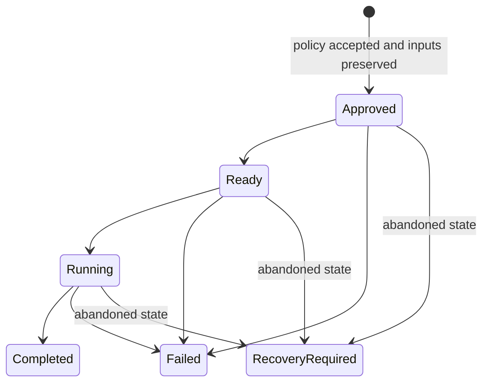

# Mock run lifecycle and interruption recovery

The mock runner uses the guarded transitions below. Every transition writes an audit request, the updated run, and an audit confirmation while holding the exclusive store lock. JSON records and the audit file are separate writes; this is not transactional database persistence.



`Completed`, `Failed`, and `RecoveryRequired` have no outgoing transitions in this mock-stage implementation. A run cannot skip from Ready to Completed, restart from a terminal state, or move its update timestamp backwards. A subsequent exercise creates a new run ID and undergoes fresh policy evaluation.

## Commands

```sh
cargo run -p purplenet-cli -- list-runs
cargo run -p purplenet-cli -- recover-interrupted --actor example-recovery-owner
```

`list-runs` returns a JSON array sorted by run ID under the store lock. `recover-interrupted` returns the recovered IDs. A second recovery returns an empty array without creating redundant transition records. Actor names are recorded but are not authenticated identities.

Every new authorized `run-mock` also performs recovery before creating its own run. The mock runner holds the exclusive lock for its full execution; once a later process acquires it, any remaining Approved, Ready, or Running record is abandoned by a cooperative runner. Recovery marks these records `recovery_required` and preserves their ID, approved-input snapshots, and observations. No events are replayed or resumed. The explicit recovery command waits for a currently active cooperative runner to release its lock; it is not an emergency stop command.

The inventory reader rejects malformed JSON, unknown run versions, mismatched filenames/IDs, symlinked JSON entries, invalid timestamps, or more than 10,000 runs. It reads the inventory before recovery mutations, so a malformed record blocks recovery and new dispatch. Existing run inventory requires a verifiable local audit chain. A fresh empty store can have no audit file. Non-JSON temporary files are ignored.

## Operator procedure after interruption

1. Preserve a copy of the state directory before manual repairs or resets.
2. Run `recover-interrupted` with a named recovery actor, then `list-runs` and `verify-audit`.
3. Inspect each recovered run and its preserved inputs; export a mock report when the input snapshot is available and consistent.
4. Record the cause and the evidence location in the project issue. For a future live adapter, a separate owner-approved cleanup and service-health procedure will be required before closure.
5. Start a new exercise only with valid scope and approval. Recovery never renews an approval or resumes an old run.

If inventory or audit verification fails, preserve the error and original files and investigate; do not delete the failing entry to force dispatch. Recovery itself can be interrupted between audit intent and state persistence. Rerunning it handles remaining active records; a terminal recovery state stays terminal. Atomic state writes do not make the entire audit/state sequence transactional or externally tamper-proof.

## Planned extensions

This lifecycle covers synthetic local execution. Authenticated recovery acknowledgement, stop requests and acknowledgements, controller leases, cleanup verification, recovery closure, transactional transition storage, and adapter-specific recovery are still open. The eventual service must define how concurrent controllers and adapters coordinate ownership before relaxing the full-run lock.
