# PurpleNet threat model v1

**Status:** engineering baseline for the mock-stage project, 19 November 2026.

**Scope:** one administration domain and one explicitly authorized lab network.

**Review trigger:** any new actor role, executable adapter, sensor connector, evidence export, AI capability, network route, or production deployment.

This model uses data flows, trust boundaries, misuse cases, mitigations, and review gates, following the [OWASP Threat Modeling Cheat Sheet](https://cheatsheetseries.owasp.org/cheatsheets/Threat_Modeling_Cheat_Sheet.html). The response and recovery gates are informed by [NIST SP 800-61 Rev. 3](https://csrc.nist.gov/pubs/sp/800/61/r3/final); the development controls are informed by [NIST SSDF](https://csrc.nist.gov/pubs/sp/800/218/final). These references guide the design and do not certify the project.

## Security objectives and protected assets

1. No action reaches an asset outside the exact approved network, named asset list, scenario, and time window.
2. An operator cannot approve their own exercise; approval and execution are attributable to authenticated identities before live use.
3. Scenario and connector inputs cannot turn into arbitrary command execution.
4. Sensor gaps, parser failures, stale data, and degraded service remain visible as unknown or degraded outcomes.
5. Evidence remains confidential, traceable to source events and versions, and tampering is detectable.
6. Stop and recovery decisions take precedence over scheduled work; a restart never silently resumes a run.
7. AI output can explain evidence but cannot approve, schedule, dispatch, or change scope.

Protected assets are scope and approval records; scenario manifests; run state; connector credentials; lab VM and host availability; source telemetry; audit and evidence records; operator and asset-owner identities; and generated reports.

## System and data flows

```mermaid
flowchart LR
  Operator[Operator / approver] -->|scope, approval, request| CLI[CLI now; API later]
  CLI -->|untrusted files and identity claims| Policy[Deterministic policy]
  Catalog[Reviewed scenario data] --> Policy
  Policy -->|allowed typed action| Runner[Mock runner now; restricted adapter later]
  Runner -->|synthetic event now| Store[Local JSON and audit now; transactional store later]
  Sensor[Independent lab sensor, planned] -->|untrusted telemetry| Ingest[Restricted connector, planned]
  Ingest --> Store
  Store -->|filtered evidence, planned| Report[Report and optional read-only AI]
  Runner -.->|future bounded action| Lab[Isolated lab VM]
  Lab --> Sensor
```

The diagram shows both current and planned components. Today there is no API, live adapter, independent sensor, evidence export, or AI runtime. The CLI reads local JSON, checks policy, emits synthetic events, and writes local run and audit files. The proposed libvirt network at `10.77.0.0/24` is not deployed; `virsh` was absent during setup. A libvirt network without a forwarding element does not prevent a guest with another interface from reaching another network, and the guest can still reach the host bridge. See [libvirt network format](https://libvirt.org/formatnetwork.html).

| Boundary | Data crossing it | Trust rule |
|---|---|---|
| TB1: human to CLI/API | identity, scope, approval, run/stop request | Authenticate actor and authorize each mutation; never infer authorization from a name in JSON. |
| TB2: files/catalog to policy | scope, approval, scenario manifests | Parse strict versioned schemas; bind exact digests; reject unknown fields and stale windows. |
| TB3: policy to runner/adapter | target, typed action, quota, deadline | Dispatch only reviewed action types after a fresh policy decision; adapter cannot widen scope. |
| TB4: controller to lab network | traffic or endpoint action, future only | Check exact asset identity, route/interface, exclusion, rate, and independent owner approval before live use. |
| TB5: sensor to ingest | logs, timestamps, source IDs, text fields | Treat events as hostile data; bound size, validate schema, preserve provenance, report gaps. |
| TB6: ingest to evidence store/report | event data, derived findings | Restrict reads/exports, minimize sensitive fields, retain source IDs and parser outcomes. |
| TB7: evidence to AI, optional | untrusted event text and retrieved documents | Read-only role with no action tools; treat output as untrusted and validate citations. |
| TB8: host to virtual network | host bridge, guest interfaces, routes | Review host firewall and all guest NICs/routes; a no-forwarding XML is only one isolation control. |

## Misuse cases and control plan

**Severity** is an engineering priority for this project, not a quantified likelihood. “Implemented” describes the mock slice only. “Required” controls must be completed before the associated capability is enabled.

| ID | Misuse or failure | Severity | Existing control | Required control and evidence |
|---|---|---|---|---|
| TM-01 | Operator edits an approval, impersonates an approver, or self-approves. | Critical | Distinct actor and approver *strings*; scope digest and window check. | Authenticated identities, role checks, separately recorded approval, audit of every mutation; deny self-approval and forged identity in integration checks. |
| TM-02 | Scope expands through CIDR, DNS, asset rename, route, or interface drift. | Critical | Exact named asset ID/IP, CIDR, exclusion, and digest checks for mock events. | Reconcile asset inventory and active routes before dispatch and on relevant change; reject ambiguity and stop on drift; record route/interface evidence. |
| TM-03 | A scenario pack or adapter smuggles an arbitrary command or unreviewed action. | Critical | Scenario contains data-only mock events; no shell field. | Typed allowlisted adapter protocol, signed or reviewed manifests, sandboxed connector process, no generic shell endpoint; inspect schema and adapter permissions. |
| TM-04 | Scheduled work continues after stop, expiry, service degradation, or controller restart. | Critical | Window is checked during mock execution. | Durable state machine, lease/deadline, global stop, idempotent cleanup, no silent restart resume; fault-injection record before any live adapter. |
| TM-05 | Compromised connector uses credentials to approve runs or write false evidence. | High | No connector exists yet. | Separate process and restricted identity; ingest-only permissions; source authentication and per-source health; replay/tamper checks. |
| TM-06 | Sensor outage or parser error is reported as successful non-detection or clean result. | High | Synthetic events are labeled as mock. | Explicit `not_observable`, `connector_unavailable`, `parser_error`, and `not_evaluated` states; source heartbeat and completeness; fixture replay. |
| TM-07 | Event text, labels, or report fields inject instructions or unsafe markup. | High | Mock labels have a length limit. | Treat telemetry as data, escape output, bound bytes/depth, reject malformed encodings, sanitize display only after preserving raw provenance safely. |
| TM-08 | AI follows instructions embedded in logs or reports and initiates an action. | Critical | No AI runtime exists. | Read-only AI service with no approval/scheduler/adapter tools; enforce policy at tool boundaries; adversarial evidence review. See [OWASP Prompt Injection Prevention](https://cheatsheetseries.owasp.org/cheatsheets/LLM_Prompt_Injection_Prevention_Cheat_Sheet.html). |
| TM-09 | Evidence is modified, deleted, or replaced by a writer with store access. | High | Local hash-linked audit sequence. | Append-only or externally anchored audit, restricted storage roles, immutable export manifests, backup and restore checks; prove tamper detection independently. |
| TM-10 | Sensitive telemetry, credentials, or personal data leaks through storage, export, or AI. | High | No live telemetry or export yet. | Field inventory, minimization, role-based access, encryption, redaction, export audit, approved retention and deletion; privacy review before production telemetry. |
| TM-11 | Flooded or malformed telemetry exhausts controller resources. | High | Mock event count capped at 100 by schema. | Ingest size/rate limits, bounded queues, backpressure, parser isolation, resource budgets, degraded-state alarm. |
| TM-12 | Guest uses a second NIC, host bridge, or forwarding path to leave the lab. | Critical | Proposed XML has no forwarding element; host bridge IP is excluded from scope. | Inspect every guest NIC/route, host firewall and network XML after deployment; no live exercise until isolation evidence is recorded. |
| TM-13 | Local state is lost or overwritten, leaving a misleading “completed” run. | High | Atomic JSON write and hash-linked audit. | Transactional state transitions, crash recovery, independent backup/restore drill, incomplete-run detection. |
| TM-14 | Dependency or release artifact is replaced before deployment. | High | Cargo lockfile committed. | Dependency review, reproducible build record, release signing and verification, credential separation, update process. |

## Current residual risk and release gates

The mock CLI is appropriate for local development demonstrations only. An attacker with local write access can alter both JSON records and the hash-linked audit chain. Actor and approver names are caller-supplied strings. The proposed network has not been deployed or inspected on a libvirt host. None of these conditions should be interpreted as approval for live activity.

Before connecting a live adapter or real sensor, require: a named network owner; complete guest inventory and exact scope; host and guest route/interface review; human approval bound to the scope and scenario digests; authenticated actors; a stop and recovery owner; connector permissions; sensor health and gap states; and a recorded rollback point. Critical open items TM-01 through TM-04 and TM-12 block live action. A sensor can be connected read-only only after TM-05 through TM-07, TM-10, and TM-11 have an implementation plan and privacy review.

Review this model at the phase-zero gate and after each change trigger. For each reviewed risk, record an owner, decision (`mitigate`, `accept`, or `defer`), evidence link, and review date in the implementation tracker or a later risk register. An accepted risk does not override scope or approval checks. The network owner must approve any live lab boundary separately.
